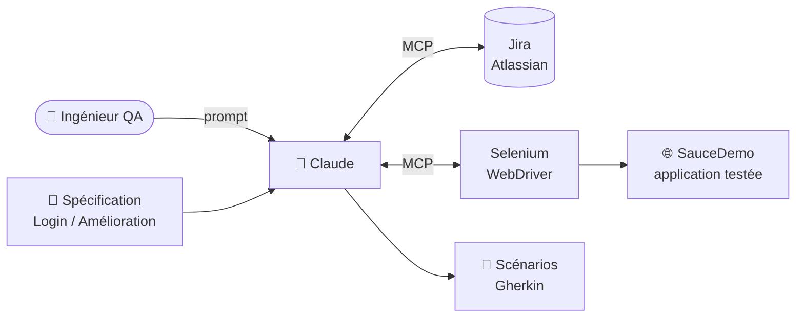
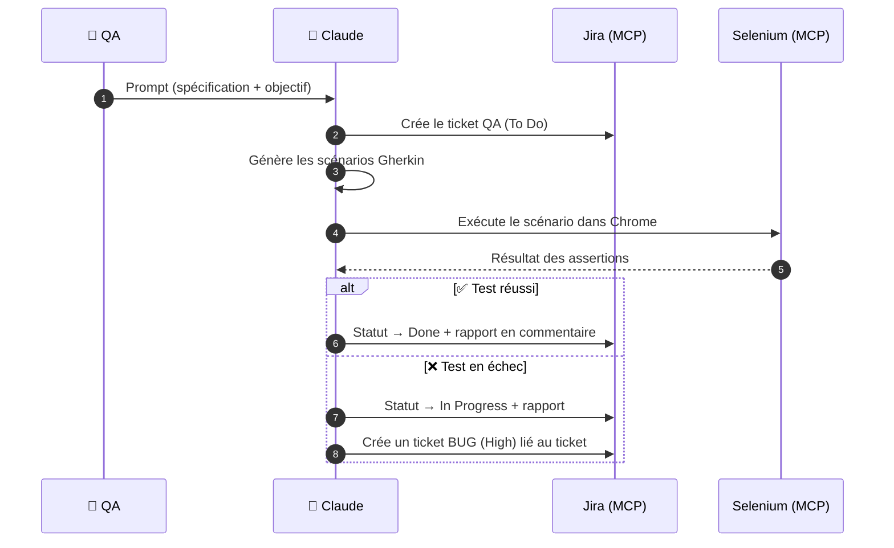

<p align="center">
  
</p>

<p align="center">
  
  
  
  
  
  
</p>

<p align="center">
  <b>Un agent QA piloté par l'IA : de la spécification au rapport de bug, sans écrire une ligne de code de test.</b><br>
  <i>An AI-driven QA agent: from spec to bug report, powered by Claude and the Model Context Protocol.</i>
</p>

<p align="center">
  <a href="docs/Guide_Prompts_QA_Workflow.pdf"><b>📄 Guide des prompts (PDF)</b></a> ·
  <a href="prompts/"><b>📚 Prompts</b></a> ·
  <a href="docs/demo.md"><b>🎥 Démo</b></a> ·
  <a href="docs/mcp-setup.md"><b>⚙️ Installation</b></a>
</p>

---

## 🎯 Le projet

Après avoir **configuré deux serveurs MCP** (Atlassian Jira et Selenium), j'ai mis en place un workflow QA simple, piloté uniquement par des **prompts en langage naturel**, centré sur trois actions :

1. **Création des scénarios** : Claude lit une spécification et génère les scénarios de test au format **Gherkin / Cucumber**.
2. **Exécution en temps réel** : Claude pilote **Selenium** et exécute les scénarios étape par étape (Given / When / Then) dans Chrome.
3. **Déclaration de bug** : en cas d'échec, Claude analyse la cause, crée un **ticket BUG dans Jira** et le lie au ticket concerné.

## 🏗️ Architecture



## 🔁 Workflow



## 📊 Résultats de la démo

| Ticket | Description | Statut | Résultat |
|---|---|---|---|
| `KAN-20` | QA Login : connexion `standard_user` | To Do → **Done** | ✅ 8/8 étapes, 100 %, ~3 s |
| `KAN-21` | QA Enhancement : nouvel utilisateur `Claude123` | To Do → **In Progress** | ❌ utilisateur non reconnu |
| `KAN-22` | **[BUG]** Claude123 n'est pas reconnu (High) | To Do | 🔗 *blocks* `KAN-21` |

➡️ Rapports complets : [rapport d'exécution KAN-20](reports/KAN-20_execution_report.md) · [rapport de bug KAN-22](reports/KAN-22_bug_report.md)

## 📚 Les prompts

| # | Prompt | Sortie |
|---|---|---|
| 00 | [Connexion à Jira](prompts/00-connexion-jira.md) | Liste des projets |
| 01 | [Ticket Jira](prompts/01-ticket-jira.md) | Ticket QA en To Do |
| 02 | [Scénarios Gherkin](prompts/02-scenarios-gherkin.md) | [`login.feature`](features/login.feature) |
| 03 | [Exécution Selenium & sync Jira](prompts/03-execution-selenium.md) | Test exécuté + ticket mis à jour |
| 04 | [Workflow amélioration](prompts/04-workflow-amelioration.md) | Cycle complet en un seul prompt |
| 05 | [Déclaration de bug](prompts/05-declaration-bug.md) | Ticket BUG lié |

📄 Tous les prompts sont aussi réunis dans le **[Guide des prompts (PDF)](docs/Guide_Prompts_QA_Workflow.pdf)**.

## 🚀 Reproduire le projet

1. Installer [Claude Desktop](https://claude.ai/download), Node.js 18+ et Chrome.
2. Configurer les serveurs MCP Jira et Selenium : voir **[docs/mcp-setup.md](docs/mcp-setup.md)**.
3. Joindre une spécification (ex. [`specs/Login.md`](specs/Login.md)) dans Claude.
4. Lancer les prompts dans l'ordre, de [00](prompts/00-connexion-jira.md) à [05](prompts/05-declaration-bug.md).

## 📁 Structure du dépôt

```text
claude-mcp-qa-automation/
├── prompts/            # Les 6 prompts du workflow, prêts à copier
├── specs/              # Spécifications d'entrée (Login, Amélioration)
├── features/           # Scénarios Gherkin générés par Claude
├── reports/            # Rapport d'exécution et rapport de bug générés
├── docs/
│   ├── Guide_Prompts_QA_Workflow.pdf
│   ├── mcp-setup.md    # Installation des serveurs MCP
│   └── demo.md         # Déroulé de la vidéo de démonstration
├── scripts/
│   └── build_pdf.py    # Régénère le guide PDF (pip install reportlab)
├── config/             # Exemple de configuration Claude Desktop
└── assets/
```

## 🛠️ Stack

| Outil | Rôle |
|---|---|
| **Claude** (Sonnet 4.6) | Agent : analyse, génération, orchestration |
| **MCP** | Protocole qui connecte Claude aux outils |
| **Jira** (Atlassian) | Gestion des tickets QA et des bugs |
| **Selenium WebDriver** | Exécution des tests dans Chrome |
| **Cucumber / Gherkin** | Formalisation BDD des scénarios |
| **SauceDemo** | Application web de test |

## 🔮 Prochaines étapes

- [ ] Intégration **GitHub** : tester automatiquement chaque Pull Request
- [ ] Exécution avec **Playwright**
- [ ] Serveur MCP personnalisé `qa-metrics` pour suivre les indicateurs de qualité
- [ ] Notification de l'équipe (Slack / email)

## 👤 Auteur

**Adam Chouk** · Fullstack Spring | DevOps | QA Automation

[](https://github.com/adama007)
<!-- Ajouter ici le lien LinkedIn : [](https://www.linkedin.com/in/VOTRE-PROFIL) -->

---

<p align="center"><sub>Projet de démonstration. Les tests portent sur <a href="https://www.saucedemo.com/">SauceDemo</a>, une application publique conçue pour l'entraînement à l'automatisation.</sub></p>
